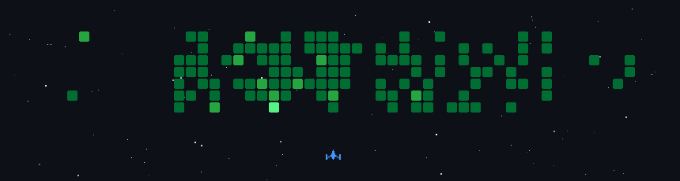

  

<h1 align="center">♥ 𝚂𝚊𝚢 𝙲𝚑𝚎𝚎𝚜𝚎! 𝚆𝚎𝚕𝚌𝚘𝚖𝚎 𝚝𝚘 𝚖𝚢 𝙶𝚒𝚝𝚑𝚞𝚋! 𝙸'𝚖 𝚂𝚛𝚒𝚓𝚊 ♥</h1>

<h2>⋆｡°✩ 𝙰 𝚕𝚒𝚝𝚝𝚕𝚎 𝚊𝚋𝚘𝚞𝚝 𝚖𝚎 ✩°｡⋆</h2>

I'm a Computer Engineering student at the University of Waterloo and an aspiring Software Engineer with a passion for Full-Stack development and AI. I can never sit still and I'm always building or creating something — from coding projects and exploring new technologies to experimenting with different forms of art. I'm currently expanding my Full-Stack background into AI Engineering, leveraging Python and Machine Learning to integrate intelligence into my builds and push the boundaries of what can be created.

- 🐍 My favorite programming language is Python
- 🚀 I thrive in fast-paced environments like hackathons  
- ⚽ I love playing soccer
- 📷 I take photos of everywhere and everything
- 🏞️ My dream is to travel the world with my camera
- 🍜 I love trying new foods from different places

<h2>⋆｡°✩ My tech stack ✩°｡⋆</h2>

<!-- Programming Languages -->

<!-- ML & CV -->

<!-- Cloud -->

<!-- Tools -->

<h2>⋆｡°✩My GitHub Contributions ✩°｡⋆</h2>

Thanks for visiting! ♡

